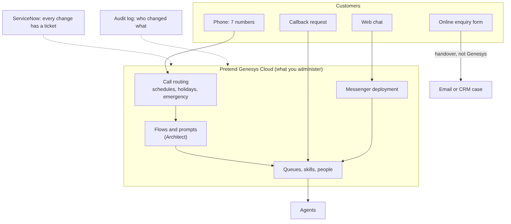

# Lesson 0. Start here (about 20 minutes)

## 1. What this lab is
You work on the phone team at **Wattle Group**, a made-up insurer. Its contact centre runs on Genesys Cloud. Your job, like a real Telephony Administrator: change menus, announcements and hours; keep queues staffed with the right people; fix faults; and write things down.

Because you have no Genesys login, this lab gives you a **pretend org**: a small file that holds the whole company (7 phone numbers, 15 queues, 14 people). PowerShell commands read and change that file. The commands print what a real change would look like, so you learn what to check and what to expect.

> **Nothing in this lab signs in to anything.** No account, no OAuth, no network. If you ever see a step that needs a Genesys login, it is labelled "real Genesys" and you can skip it.



## 2. Set-up (five steps)
1. Put the lab folder somewhere simple, for example `C:\ITSM\Labs\genesys-cloud-l1-admin-training-lab`.
2. Open **PowerShell** (the blue one, Windows PowerShell, is fine).
3. Go into the folder. Type `cd ` then the path in quotes if it has spaces.
4. If Windows blocks scripts, run these two lines once. The first only affects this window. The second removes the "downloaded from the internet" mark.
5. Start the lab.

```
cd "C:\ITSM\Labs\genesys-cloud-l1-admin-training-lab"
Set-ExecutionPolicy -Scope Process -ExecutionPolicy Bypass
Get-ChildItem -Recurse | Unblock-File
.\Start-Lab.ps1
```
**What each line does.** `cd` means "change directory", it moves you into the folder. `Set-ExecutionPolicy ... Process` relaxes the script safety rule for this window only, it is forgotten when you close the window. `Unblock-File` clears the internet-download flag so Windows trusts the files. `.\Start-Lab.ps1` loads the lab: it imports a module called `Wattle`, which holds all the pretend commands.

**Optional, for Lesson 2:** the audio checks need a free tool called ffmpeg (it reads sound files). Install it with `winget install Gyan.FFmpeg`, then **close the PowerShell window and open a new one**. A new window is needed because Windows only reads the list of programs when a window starts.

**Prove it works.** This runs 47 checks and takes about a minute:
```
.\tests\Invoke-LabTests.ps1
```
You should see `47 passed, 0 failed` (without ffmpeg you will see some SKIP lines, that is fine).

## 3. The words you need (plain English)
| Word | Plain English |
|---|---|
| Line (or DID) | A phone number the company owns. Callers dial it. |
| Call route | The front-door directory. It says: for this number, which flow runs when we are open, closed, on a holiday, or in an emergency. |
| Flow (Architect) | The script a call follows: greeting, menu, then hand-off. Built in a tool called Architect. |
| IVR / menu | The "press 1 for..." part of a flow. |
| Prompt | One recorded message (or computer voice) the flow can play. |
| Schedule, schedule group | Open hours, and the bundle of hours plus holidays that a route checks. |
| Emergency group | A big red switch that sends every caller on its routes to the emergency flow. |
| Queue | A waiting room for callers, owned by a team. |
| Skill | A label on a person (for example "Wealth") with a score from 1 to 5. A queue can require skills. |
| ACD | Automatic Call Distribution: the part that picks which agent gets the next call. |
| In-queue flow | What a caller hears while waiting: music, wait time, a callback offer. |
| EWT | Estimated wait time. |
| Callback | Instead of waiting, the caller asks us to ring them back. |
| Role, group, division | Role = what you are allowed to do. Group = a set of people. Division = a fence around data. |
| Audit log | A record of who changed what, when, under which ticket. |
| Ticket | The ServiceNow record that asks for and approves a change: INC (fault), RITM (request), CHG (change). |
| Publish | Making the saved version of a flow the live one. |

## 4. The pretend company
| Line | Number (pretend) | Depth | Notes |
|---|---|---|---|
| L1 Health sales and service | +61 3 5550 0401 | deep | 4-option menu. Callbacks. Main practice line. |
| L2 General inquiries | +61 3 5550 0402 | deep | 3-option menu. |
| L3 Overseas visitors | +61 3 5550 0403 | deep | One greeting, then straight to a queue. |
| L4 Insurance support | +61 3 5550 0404 | light | 2 options. |
| L5 Wealth and investments | +61 3 5550 0405 | light | Outage notice is ON. |
| L6 Funeral services | +61 3 5550 0406 | light | Outage notice is ON. |
| L7 Wholesale wealth | +61 3 5550 0407 | light | One queue. |

Phone lines are open **Monday to Friday, 8:30am to 6pm** (Melbourne time). Web chat is open **Monday to Friday, 8:30am to 8pm**. The numbers are made up in the safe "drama" style. Do not dial them.

## 5. How the pretend commands match real Genesys
| Pretend command | Real Genesys area | Notes |
|---|---|---|
| `Get-WgCallRoute`, `Trace-WgCall` | Call Routing, place a test call | Real: you place a test call and read the Interactions view. |
| `Get-WgFlow`, `Publish-WgFlow` | Architect > Flows | Publish is the same idea. |
| `Get-WgPrompt`, `Set-WgPromptAudio` | Architect > Prompts | Real prompts keep audio per language, not a version list. The lab keeps versions so you can SEE the republish rule. |
| `Get-WgScheduleGroup`, `Test-WgSchedule` | Schedules, Schedule Groups | |
| `Set-WgEmergencyGroup` | Emergency Groups > Activate | |
| `Get-WgQueue`, `Add-WgQueueMember` | Queues | |
| `Get-WgUser`, `Get-WgRole` | People and Permissions | |
| `Get-WgAudit` | Audit Viewer | |
| `Request-WgCallback`, `Trace-WgCall -AcceptCallback` | Callbacks, Create Callback action | |
| `Test-WgChat` | Messenger and inbound message flow | |

> **Real Genesys needs an OAuth client** (an ID and a secret you create in the admin screens) to run the same jobs from PowerShell or scripts. You do not have one, so this lab never asks for it. Genesys publishes its Platform API, and a command-line tool called the Genesys Cloud CLI uses it. When you get an org, you can map each lesson to the matching API call.

## 6. Rules of the lab
- Every change needs a **ticket number** (`INC0000123`, `RITM0000123` or `CHG0000123`). The commands refuse without one. That is deliberate: real changes have tickets, and the audit log records them.
- `Reset-WgOrg` puts everything back. Use it whenever you want a clean start.
- Look at what a command printed. Do not just run commands: read them.
- Dates in this book use the form `"2026-11-16 10:15"` (year-month-day, 24-hour time). 16 Nov 2026 is a Monday.

## 7. First look
```
PS> Get-WgLine
Id Name                     Number          CallRoute    Depth
-- ----                     ------          ---------    -----
L1 Health sales and service +61 3 5550 0401 CR-Health    deep
L2 General inquiries        +61 3 5550 0402 CR-General   deep
L3 Overseas visitors        +61 3 5550 0403 CR-Overseas  deep
L4 Insurance support        +61 3 5550 0404 CR-Insurance light
L5 Wealth and investments   +61 3 5550 0405 CR-Wealth    light
L6 Funeral services         +61 3 5550 0406 CR-Funeral   light
L7 Wholesale wealth         +61 3 5550 0407 CR-Wholesale light
PS> Get-Command -Module Wattle | Select-Object -ExpandProperty Name
Add-WgHoliday
Add-WgQueueMember
Add-WgUserSkill
Compare-WgQueueMembership
Disable-WgUser
Export-WgCallMap
Get-WgAudit
Get-WgCallback
Get-WgCallRoute
Get-WgEmergencyGroup
Get-WgEnquiryDue
Get-WgFlow
Get-WgLine
Get-WgNotice
Get-WgPrompt
Get-WgPromptUsage
Get-WgQueue
Get-WgRole
Get-WgScheduleGroup
Get-WgUser
Publish-WgFlow
Remove-WgQueueMember
Request-WgCallback
Reset-WgOrg
Set-WgEmergencyGroup
Set-WgNotice
Set-WgPromptAudio
Test-WgAnnouncement
Test-WgChat
Test-WgHolidayCoverage
Test-WgSchedule
Trace-WgCall
```
**What you just did.** `Get-WgLine` lists the numbers. The second command lists every command in the lab. Commands are named `Verb-Noun`: `Get-` shows things, `Set-` changes one thing, `Add-`/`Remove-` add and take away, `Test-` checks something, `Trace-` follows a call. `Wg` stands for Wattle Group.

## 8. Improvement log
Every lesson adds one improvement. They are collected in `docs/IMPROVEMENT-LOG.md` with the reason. Real continuous improvement works like this: find a weak spot, make one change, say WHY, and measure it.

