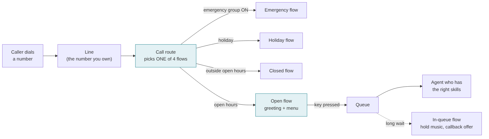
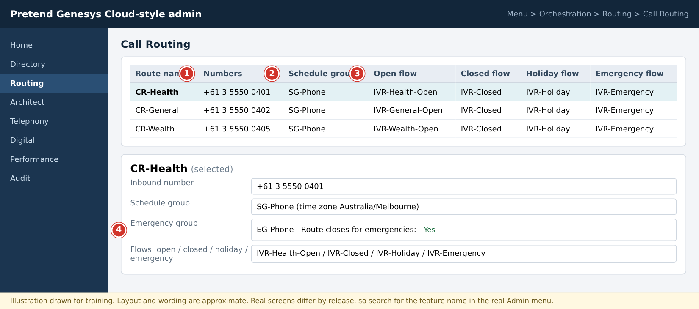
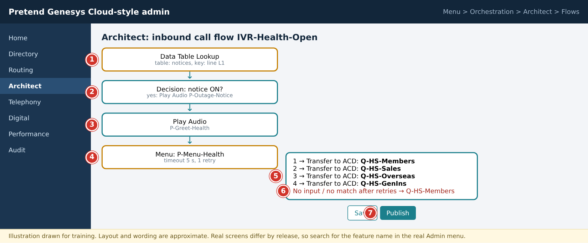

# Lesson 1. How a call travels (about 40 minutes)

## 1. The ticket
> **Training ticket TRN-1.** A caller says: "I pressed 1 on the health line and ended up in the wrong place." Find out where a call goes, explain it in plain English, and make sure the written map is accurate.

## 2. The idea in plain English
Think of a hotel. The **street address** is the phone number. The **front-door directory** is the call route: it looks at the clock and decides which receptionist script to use. The **script** is the flow: a greeting and a menu. The **waiting room** is the queue. The **person who helps you** is the agent.



The big idea: **one call route holds four flows**: open, closed, holiday and emergency. Genesys checks the state first, then runs the matching flow. So "are we open?" is decided **before** the menu is ever played.

## 3. In the screen (GUI)
**Where:** Call Routing (the Genesys help page says: a call route maps a call flow to a dialled number, and you set the open, closed, holiday and emergency flows on it). Menus move between releases, so use the Admin search box for "Call Routing".

1. **Numbers:** the phone numbers that reach this route.
2. **Schedule group:** the hours and holidays this route checks.
3. **The four flows:** which flow runs in each state.
4. **Emergency group:** the switch for emergencies. The route must be allowed to close for emergencies.

Now the flow itself. **Where:** Architect, open the flow (it is called IVR-Health-Open).

1. A **notice slot** lookup (this is how the outage notice is switched on; Lesson 2).
2. A decision: is the notice ON?
3. **Play Audio:** the greeting prompt.
4. **Menu:** plays the menu prompt, waits 5 seconds, allows 1 retry.
5. What each key does: it **transfers to a queue**.
6. What happens when the caller does nothing, or presses a wrong key, after the retries.
7. **Publish:** nothing you changed counts until you publish.

## 4. In PowerShell
### Step 1. See the numbers
```
PS> Get-WgLine
Id Name                     Number          CallRoute    Depth
-- ----                     ------          ---------    -----
L1 Health sales and service +61 3 5550 0401 CR-Health    deep
L2 General inquiries        +61 3 5550 0402 CR-General   deep
L3 Overseas visitors        +61 3 5550 0403 CR-Overseas  deep
L4 Insurance support        +61 3 5550 0404 CR-Insurance light
L5 Wealth and investments   +61 3 5550 0405 CR-Wealth    light
L6 Funeral services         +61 3 5550 0406 CR-Funeral   light
L7 Wholesale wealth         +61 3 5550 0407 CR-Wholesale light
```
**What it does.** Lists the 7 lines. `Id` is the short name we use in tickets.

### Step 2. Open the call route
```
PS> Get-WgCallRoute -Id CR-Health
==> Call route CR-Health  (Health sales and service)
  Numbers pointing here : +61 3 5550 0401
  Schedule group        : SG-Phone
  Emergency group       : EG-Phone  (route closes for emergencies: True)
  open      flow        : IVR-Health-Open  (published v1)
  closed    flow        : IVR-Closed  (published v2)
  holiday   flow        : IVR-Holiday  (published v1)
  emergency flow        : IVR-Emergency  (published v2)
```
**What it does.** `Get-WgCallRoute` shows a call route. `-Id CR-Health` says which one (a **parameter**: a dash, a name, then the value). You can see the number, the schedule group and the four flows. Closed, holiday and emergency flows are **shared** by every route. That means one change fixes all seven lines.

### Step 3. Read the menu flow like a script
```
PS> Get-WgFlow -Id IVR-Health-Open -Steps
==> Flow IVR-Health-Open  (Health - open, inboundCall, published v1)
  1. Look up the notice slot for line L1 in data table "notices". If it is ON, play that notice first.
  2. Play prompt P-Greet-Health
  3. Menu: play P-Menu-Health, wait 5 s, 1 retry. Keys: 1 = existing member -> Q-HS-Members; 2 = join or quote -> Q-HS-Sales; 3 = overseas visitors -> Q-HS-Overseas; 4 = home, car or travel -> Q-HS-GenIns. No input after the retries -> Q-HS-Members
```
**What it does.** `-Steps` prints the flow as numbered steps, the same order as the Architect picture. Read the Menu line: keys 1 to 4, each with a queue, and the fallback.

### Step 4. Follow a real call (the star command)
```
PS> Trace-WgCall -Number "+61 3 5550 0401" -At "2026-11-16 10:15" -Keys 1
==> Call to +61 3 5550 0401 at Mon 16 Nov 2026 10:15
1. The number belongs to line L1 "Health sales and service". Its call route is CR-Health.
2. The route asks schedule group SG-Phone: OPEN.  (Monday 10:15 is inside SCH-Phone-Open 08:30-18:00)
3. The route runs its open flow: IVR-Health-Open (published v1).
4. Notice slot for L1 is OFF, so nothing extra plays.
5. Plays P-Greet-Health (the flow's published snapshot is v1).
       Caller hears: "Thanks for calling Wattle Health."
6. Menu, pass 1 of 2: plays P-Menu-Health (v1).
       Caller hears: "If you are already a member and need help with your cover, press 1. To join or ask for a quote, press 2. For overseas visitor and student cover, press 3. For home, car or travel insurance, press 4."
   Caller presses 1: "existing member".
7. The call joins queue Q-HS-Members "Health - Members" (routing Standard, skills: Health).
   Genesys would alert: Bree Nguyen (proficiency 5), Kim Lowe (proficiency 5), Alex Reed (proficiency 4)  (best available skills)
```
**Read it line by line.** `Trace-WgCall` pretends a call happens. `-Number` is the number dialled (spaces are fine). `-At` is the date and time of the call. `-Keys 1` means the caller presses 1. The output says: which line, what the schedule group decided, which flow ran, what the caller **heard** (the purple text in a real window), and which queue the call joined and **who Genesys would alert**.

### Step 5. What if the caller does nothing?
```
PS> Trace-WgCall -Number "+61 3 5550 0401" -At "2026-11-16 10:15"
==> Call to +61 3 5550 0401 at Mon 16 Nov 2026 10:15
1. The number belongs to line L1 "Health sales and service". Its call route is CR-Health.
2. The route asks schedule group SG-Phone: OPEN.  (Monday 10:15 is inside SCH-Phone-Open 08:30-18:00)
3. The route runs its open flow: IVR-Health-Open (published v1).
4. Notice slot for L1 is OFF, so nothing extra plays.
5. Plays P-Greet-Health (the flow's published snapshot is v1).
       Caller hears: "Thanks for calling Wattle Health."
6. Menu, pass 1 of 2: plays P-Menu-Health (v1).
       Caller hears: "If you are already a member and need help with your cover, press 1. To join or ask for a quote, press 2. For overseas visitor and student cover, press 3. For home, car or travel insurance, press 4."
   Caller says and presses nothing. After 5 seconds the menu plays again.
6. Menu, pass 2 of 2: plays P-Menu-Health (v1).
       Caller hears: "If you are already a member and need help with your cover, press 1. To join or ask for a quote, press 2. For overseas visitor and student cover, press 3. For home, car or travel insurance, press 4."
   Caller says and presses nothing. After 5 seconds the menu plays again.
 WARN     No valid key after 2 passes, so the flow sends the call to the default: Q-HS-Members.
7. The call joins queue Q-HS-Members "Health - Members" (routing Standard, skills: Health).
   Genesys would alert: Bree Nguyen (proficiency 5), Kim Lowe (proficiency 5), Alex Reed (proficiency 4)  (best available skills)
```
**What you see.** No keys: the menu plays, waits 5 seconds, plays again, then the fallback sends the call to the Members queue. This is the behaviour you would hear if you stayed silent on a real call: the menu repeats once.

### Step 6. What if they press a wrong key twice?
```
PS> Trace-WgCall -Number "+61 3 5550 0401" -At "2026-11-16 10:15" -Keys 7,8
==> Call to +61 3 5550 0401 at Mon 16 Nov 2026 10:15
1. The number belongs to line L1 "Health sales and service". Its call route is CR-Health.
2. The route asks schedule group SG-Phone: OPEN.  (Monday 10:15 is inside SCH-Phone-Open 08:30-18:00)
3. The route runs its open flow: IVR-Health-Open (published v1).
4. Notice slot for L1 is OFF, so nothing extra plays.
5. Plays P-Greet-Health (the flow's published snapshot is v1).
       Caller hears: "Thanks for calling Wattle Health."
6. Menu, pass 1 of 2: plays P-Menu-Health (v1).
       Caller hears: "If you are already a member and need help with your cover, press 1. To join or ask for a quote, press 2. For overseas visitor and student cover, press 3. For home, car or travel insurance, press 4."
 WARN     Caller presses 7: not a menu option. The flow says it did not understand and plays the menu again.
6. Menu, pass 2 of 2: plays P-Menu-Health (v1).
       Caller hears: "If you are already a member and need help with your cover, press 1. To join or ask for a quote, press 2. For overseas visitor and student cover, press 3. For home, car or travel insurance, press 4."
 WARN     Caller presses 8: not a menu option. The flow says it did not understand and plays the menu again.
 WARN     No valid key after 2 passes, so the flow sends the call to the default: Q-HS-Members.
7. The call joins queue Q-HS-Members "Health - Members" (routing Standard, skills: Health).
   Genesys would alert: Bree Nguyen (proficiency 5), Kim Lowe (proficiency 5), Alex Reed (proficiency 4)  (best available skills)
```
**What you see.** `-Keys 7,8` means: press 7, then press 8. Neither is a menu option, so the same fallback happens.

### Step 7. A line with no menu
```
PS> Trace-WgCall -Number "+61 3 5550 0403" -At "2026-11-16 10:15"
==> Call to +61 3 5550 0403 at Mon 16 Nov 2026 10:15
1. The number belongs to line L3 "Overseas visitors". Its call route is CR-Overseas.
2. The route asks schedule group SG-Phone: OPEN.  (Monday 10:15 is inside SCH-Phone-Open 08:30-18:00)
3. The route runs its open flow: IVR-Overseas-Open (published v1).
4. Notice slot for L3 is OFF, so nothing extra plays.
5. Plays P-Greet-Overseas (the flow's published snapshot is v1).
       Caller hears: "Thanks for calling Wattle Health, overseas visitor and student cover."
6. The flow transfers the call to queue Q-HS-Overseas.
7. The call joins queue Q-HS-Overseas "Health - Overseas" (routing Standard, skills: Health, Overseas).
   Genesys would alert: Dana Singh (proficiency 4), Eli Moore (proficiency 3.5)  (best available skills)
```
**What you see.** The overseas visitors line plays a greeting and goes straight to a queue.

> **Real Genesys.** You would place a test call to a test number, and then look at the call in the Interactions view and at the flow's execution. The lab command is a safe stand-in. A real check needs a login and a phone.

## 5. Why it is built this way (architect view)
- **State first, menu second.** Putting open/closed/holiday/emergency in the route means every menu flow stays simple. If hours were checked inside each menu flow, seven flows would each need the same logic, and one mistake would hide in one of them.
- **Shared closed, holiday and emergency flows.** One message to fix, one place to approve. The trade-off: a change touches all seven lines at once, so test it properly.
- **One open flow per line, kept small.** Easy to read, easy to roll back. A giant flow with every line's menu would be hard to test.
- **A defined fallback.** After two wasted passes the call goes to the Members queue. The design choice: never hang up on a member who simply did not press anything. The alternative (disconnect) is cheaper but loses calls.
- **Queues named for the job** (`Q-HS-Members`), flows named `IVR-<Line>-<State>`. Names are your search box at 3am.

## 6. What goes wrong (first checks)
| Symptom | First check | Command |
|---|---|---|
| "I pressed 1 and got the wrong team" | Is the key mapped to the right queue? Does the prompt wording match the mapping? | `Get-WgFlow -Id <flow> -Steps` |
| "Nothing changed after the update" | Was the flow published? | Lesson 2 |
| Number rings but "not in service" | Is the number assigned to a line and a route? | `Get-WgLine -Number <n>` |
| Caller waits forever | Does anyone in the queue hold every required skill? | `Get-WgQueue -Id <queue>` (Lesson 4) |

## 7. Improvements added in this lesson, and WHY
1. **A generated call map.** Run the command below. It writes the whole map (numbers, keys, queues) from the system itself. **Why:** documents drift. Someone changes a menu and forgets the Word file. A map generated from the system cannot be out of date, and keeping documentation current is a stated duty of the role.
2. **A named fallback instead of silence.** Every menu has an explicit "no input" destination. **Why:** unplanned behaviour is where complaints come from. Writing it down turns an accident into a decision you can review.

```
PS> Export-WgCallMap
# Call map (generated 2026-11-13 04:44)  Pretend company. Do not edit by hand: run Export-WgCallMap.
## L1 - Health sales and service  (+61 3 5550 0401)
- Hours group: SG-Phone.  Emergency group: EG-Phone.  Open flow: IVR-Health-Open v1.
- Notice slot: off
- Press 1: existing member -> Q-HS-Members
- Press 2: join or quote -> Q-HS-Sales
- Press 3: overseas visitors -> Q-HS-Overseas
- Press 4: home, car or travel -> Q-HS-GenIns
- No input after retries: Q-HS-Members

## L2 - General inquiries  (+61 3 5550 0402)
- Hours group: SG-Phone.  Emergency group: EG-Phone.  Open flow: IVR-General-Open v1.
- Notice slot: off
- Press 1: health cover -> Q-GEN-Health
- Press 2: other insurance -> Q-GEN-Ins
- Press 3: anything else -> Q-GEN-Other
- No input after retries: Q-GEN-Other

## L3 - Overseas visitors  (+61 3 5550 0403)
- Hours group: SG-Phone.  Emergency group: EG-Phone.  Open flow: IVR-Overseas-Open v1.
- Notice slot: off
- Goes straight to: Q-HS-Overseas

## L4 - Insurance support  (+61 3 5550 0404)
- Hours group: SG-Phone.  Emergency group: EG-Phone.  Open flow: IVR-Insurance-Open v1.
- Notice slot: off
- Press 1: claims -> Q-INS-Claims
- Press 2: policy changes -> Q-INS-Changes
- No input after retries: Q-INS-Claims

## L5 - Wealth and investments  (+61 3 5550 0405)
- Hours group: SG-Phone.  Emergency group: EG-Phone.  Open flow: IVR-Wealth-Open v1.
- Notice slot: ON
- Press 1: existing client -> Q-WLT-Existing
- Press 2: new enquiry -> Q-WLT-New
- No input after retries: Q-WLT-Existing

## L6 - Funeral services  (+61 3 5550 0406)
- Hours group: SG-Phone.  Emergency group: EG-Phone.  Open flow: IVR-Funeral-Open v1.
- Notice slot: ON
- Press 1: existing plan -> Q-FUN-Existing
- Press 2: arrange a plan -> Q-FUN-New
- No input after retries: Q-FUN-Existing

## L7 - Wholesale wealth  (+61 3 5550 0407)
- Hours group: SG-Phone.  Emergency group: EG-Phone.  Open flow: IVR-Wholesale-Open v1.
- Notice slot: off
- Goes straight to: Q-WHO-Desk
```

## 8. Check yourself
1. A caller dials the health line at 7pm on a Tuesday. Which of the four flows runs, and is the menu played? *(Closed flow. The menu never plays, because the route chose the closed flow first.)*
2. Why are the closed, holiday and emergency flows shared by all routes? *(One place to change and approve. Trade-off: a mistake affects all lines.)*
3. A caller says they pressed 3 for overseas cover but reached the Members team. Where do you look? *(The Menu step in the open flow: is key 3 mapped to `Q-HS-Overseas`, and does the prompt wording say the same thing?)*

