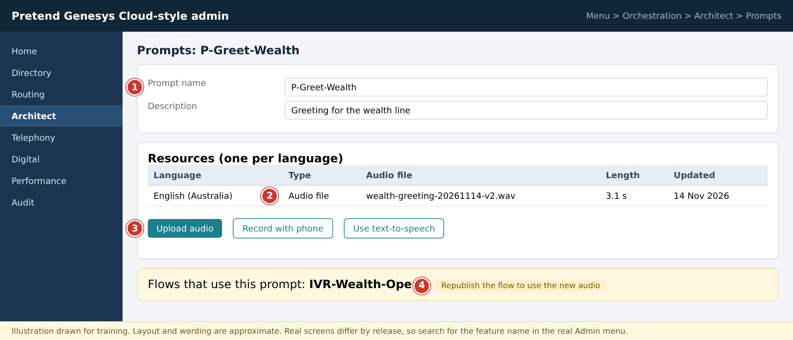

# Lesson 2. Announcements and the outage notice (about 60 minutes)

## 1. The ticket
> **RITM0010231.** The wealth line greeting needs new words. Also, a worldwide technology outage means replies will be slow: put a short notice before the greeting on the health line today, and take it off when the outage ends.

## 2. The idea in plain English
An **announcement** is a recorded message: a greeting, a menu, "we are closed". In Genesys it is stored as a **prompt**. A flow *plays* the prompt. Changing an announcement is a **MACS** job (moves, adds, changes) and the most common one you will do.

The life of an announcement, in order: **script -> record -> convert -> check -> upload -> republish the flow -> test call -> document**. Skip a step and callers hear the wrong thing.

> **The rule that catches everyone.** When you publish a flow, Genesys takes a snapshot of the prompts it uses. If you upload a new recording **after** that, callers keep hearing the OLD one until you **publish the flow again**. This is the number one reason for "I uploaded it but nothing changed".

### The file rules
| Rule | Value | Where it comes from |
|---|---|---|
| File type | WAV only. MP3 is not supported. | Genesys Resource Center, "Prompts overview" |
| Sample rate | 8,000 Hz or 11,025 Hz | Genesys |
| Size | 25 MB maximum | Genesys |
| What Genesys does | Converts uploads to 8-bit mu-law (a phone-line format) | Genesys |
| Mono, 60 seconds or less | House rule | **This lab**, not Genesys |
| No clipping: loudest point -1 dB or lower; not too quiet | House rule | **This lab**, not Genesys |
| File name `<line>-<purpose>-<yyyymmdd>-v<n>.wav` | House rule | **This lab** |
| Script text kept next to the audio (`.txt`) | House rule | **This lab** |

Always re-check the Genesys help pages before relying on a number. They can change.

## 3. In the screen (GUI)
**Where:** Architect > Prompts. A prompt has one **resource** per language: an audio file, or computer voice (text-to-speech).

1. The prompt name. Flows refer to it by name.
2. The audio file for this language, its length and when it was updated.
3. **Upload audio** (or record, or use computer voice).
4. A reminder: the flows that use this prompt must be **republished**.

> **Honest note.** Real Genesys keeps the audio resource, not a "version 1, version 2" list. The lab keeps versions so you can SEE the republish rule happen. In real life, keep your own versions in the file name (`-v2`) and in a shared folder.

## 4. In PowerShell
### Step 1. Look at the prompt as it is now
```
PS> Get-WgPrompt -Id P-Greet-Wealth
==> Prompt P-Greet-Wealth  (greeting, current version v1)
  v1  2026-10-01  file p-greet-wealth-v1.wav  ticket RITM0000001
      "Thanks for calling Wattle Wealth."
```
**What it does.** Shows the prompt, its version and the words. This is "v1".

### Step 2. Make a test recording
Your real recording would come from your phone or a recorder. Phones save `.m4a`. Convert it like this (this line is for your own file, it is not run here):
```
PS> ffmpeg -i my-recording.m4a -ar 8000 -ac 1 -c:a pcm_s16le wealth-greeting-20261114-v2.wav
```
**What each part means.** `ffmpeg` is the converter. `-i` is the input file. `-ar 8000` sets the sample rate to 8,000 Hz. `-ac 1` makes it mono (one channel). `-c:a pcm_s16le` stores plain 16-bit sound, which is allowed. The last name is the output, named by our rule.

To practise without a recording, make a 3-second beep and write its script text:
```
PS> ffmpeg -y -v error -f lavfi -i "sine=frequency=440:duration=3" -af volume=3 -ar 8000 -ac 1 -c:a pcm_s16le ./announcements/samples/wealth-greeting-20261114-v2.wav
PS> Set-Content -Path ./announcements/samples/wealth-greeting-20261114-v2.txt -Value "Thanks for calling Wattle Wealth. We are open until 6pm today."
```
**What it does.** `-f lavfi -i "sine..."` makes a test tone. `-af volume=3` makes it louder so it passes the loudness rule. `-y` overwrites without asking and `-v error` hides the chatter. `Set-Content` writes the script text file next to the audio. **The text is the master. The audio is only a copy of it.**

### Step 3. Check the file BEFORE you upload
```
PS> Test-WgAnnouncement -Path ./announcements/samples/wealth-greeting-20261114-v2.wav -Ticket RITM0010231
==> Announcement check: wealth-greeting-20261114-v2.wav
  OK   File name follows the standard.
  OK   Ticket RITM0010231 looks right.
  OK   Script text file is next to the audio.
  OK   Size 0.05 MB is under the 25 MB limit.
  OK   Sample rate 8000 Hz is accepted.
  OK   Mono, as the house rule asks.
  OK   Length 3.0 s.
  OK   Peak -8.5 dB: no clipping.
  OK   Average -11.5 dB: easy to hear.
  OK   Ready to upload. Remember: after upload, republish every flow that uses this prompt.
```
**What it does.** Runs every rule in the table: name, ticket, script text, size, sample rate, mono, length, loudness. All green means it is ready.

### Step 4. See how a bad file is caught
Make four bad files, each with one fault, then check them:
```
PS> ffmpeg -y -v error -f lavfi -i "sine=frequency=440:duration=3" -af volume=12 -ar 8000 -ac 1 -c:a pcm_s16le ./announcements/samples/wealth-greeting-20261114-v3.wav
PS> Copy-Item ./announcements/samples/wealth-greeting-20261114-v2.txt ./announcements/samples/wealth-greeting-20261114-v3.txt
PS> Test-WgAnnouncement -Path ./announcements/samples/wealth-greeting-20261114-v3.wav -Ticket RITM0010231
==> Announcement check: wealth-greeting-20261114-v3.wav
  OK   File name follows the standard.
  OK   Ticket RITM0010231 looks right.
  OK   Script text file is next to the audio.
  OK   Size 0.05 MB is under the 25 MB limit.
  OK   Sample rate 8000 Hz is accepted.
  OK   Mono, as the house rule asks.
  OK   Length 3.0 s.
  OK   Average -1.5 dB: easy to hear.
 FAIL  Peak 0 dB is too loud and may clip. House rule: -1 dB or lower.
1 problem(s). Fix them, then check again.
PS> ffmpeg -y -v error -f lavfi -i "sine=frequency=440:duration=3" -af volume=3 -ar 44100 -ac 2 -c:a pcm_s16le ./announcements/samples/wealth-greeting-20261114-v4.wav
PS> Copy-Item ./announcements/samples/wealth-greeting-20261114-v2.txt ./announcements/samples/wealth-greeting-20261114-v4.txt
PS> Test-WgAnnouncement -Path ./announcements/samples/wealth-greeting-20261114-v4.wav -Ticket RITM0010231
==> Announcement check: wealth-greeting-20261114-v4.wav
  OK   File name follows the standard.
  OK   Ticket RITM0010231 looks right.
  OK   Script text file is next to the audio.
  OK   Size 0.50 MB is under the 25 MB limit.
  OK   Length 3.0 s.
  OK   Peak -11.5 dB: no clipping.
  OK   Average -14.5 dB: easy to hear.
 FAIL  Sample rate is 44100 Hz. Genesys needs 8000 or 11025 Hz.
 FAIL  2 channels. House rule: mono.
2 problem(s). Fix them, then check again.
PS> ffmpeg -y -v error -f lavfi -i "sine=frequency=440:duration=3" -ar 8000 -ac 1 ./announcements/samples/wealth-greeting-20261114-v5.mp3
PS> Copy-Item ./announcements/samples/wealth-greeting-20261114-v2.txt ./announcements/samples/wealth-greeting-20261114-v5.txt
PS> Test-WgAnnouncement -Path ./announcements/samples/wealth-greeting-20261114-v5.mp3 -Ticket RITM0010231
==> Announcement check: wealth-greeting-20261114-v5.mp3
  OK   Ticket RITM0010231 looks right.
  OK   Script text file is next to the audio.
  OK   Size 0.00 MB is under the 25 MB limit.
 FAIL  File name does not follow the standard <line>-<purpose>-<yyyymmdd>-v<n>.wav (purposes: greeting, menu, closed, holiday, emergency, notice, hold)
 FAIL  Genesys accepts WAV only. MP3 and other formats are not supported.
 FAIL  The audio is not a real WAV file (check the container).
3 problem(s). Fix them, then check again.
PS> Test-WgAnnouncement -Path ./announcements/samples/wealth-greeting-20261114-v2.wav -Ticket hello
==> Announcement check: wealth-greeting-20261114-v2.wav
  OK   File name follows the standard.
  OK   Script text file is next to the audio.
  OK   Size 0.05 MB is under the 25 MB limit.
  OK   Sample rate 8000 Hz is accepted.
  OK   Mono, as the house rule asks.
  OK   Length 3.0 s.
  OK   Peak -8.5 dB: no clipping.
  OK   Average -11.5 dB: easy to hear.
 FAIL  Ticket "hello" is not INC/RITM/CHG plus 7 digits.
1 problem(s). Fix them, then check again.
```
**What you learned.** In order: too loud (clipping), wrong sample rate and stereo, MP3 (not allowed), and a bad ticket. Each gets a clear reason. A check like this is cheap and stops a bad file reaching callers.

### Step 5. Upload, and watch callers still hear the OLD words
```
PS> Set-WgPromptAudio -Prompt P-Greet-Wealth -Path ./announcements/samples/wealth-greeting-20261114-v2.wav -Ticket RITM0010231
==> Announcement check: wealth-greeting-20261114-v2.wav
  OK   File name follows the standard.
  OK   Ticket RITM0010231 looks right.
  OK   Script text file is next to the audio.
  OK   Size 0.05 MB is under the 25 MB limit.
  OK   Sample rate 8000 Hz is accepted.
  OK   Mono, as the house rule asks.
  OK   Length 3.0 s.
  OK   Peak -8.5 dB: no clipping.
  OK   Average -11.5 dB: easy to hear.
  OK   Ready to upload. Remember: after upload, republish every flow that uses this prompt.
  OK   Uploaded P-Greet-Wealth v2.
 WARN  Callers still hear the OLD version. Republish: IVR-Wealth-Open
PS> Get-WgPromptUsage -StaleOnly
Flow            Prompt         FlowPlays Latest Status
----            ------         --------- ------ ------
IVR-Wealth-Open P-Greet-Wealth v1        v2     STALE - republish the flow
PS> Trace-WgCall -Number "+61 3 5550 0405" -At "2026-11-16 10:15" -Keys 1
==> Call to +61 3 5550 0405 at Mon 16 Nov 2026 10:15
1. The number belongs to line L5 "Wealth and investments". Its call route is CR-Wealth.
2. The route asks schedule group SG-Phone: OPEN.  (Monday 10:15 is inside SCH-Phone-Open 08:30-18:00)
3. The route runs its open flow: IVR-Wealth-Open (published v1).
4. Notice slot for L5 is ON, so the notice plays first (prompt P-Outage-Notice).
       Caller hears: "We are sorry. Replies may be slower than usual today because of a worldwide technology outage. Thank you for your patience."
5. Plays P-Greet-Wealth (the flow's published snapshot is v1).
       Caller hears: "Thanks for calling Wattle Wealth."
6. Menu, pass 1 of 2: plays P-Menu-Wealth (v1).
       Caller hears: "If you are already a client, press 1. If you are new and want to ask about investing, press 2."
   Caller presses 1: "existing client".
7. The call joins queue Q-WLT-Existing "Wealth - Existing" (routing Standard, skills: Wealth).
   Genesys would alert: Ivan Cole (proficiency 4)  (best available skills)
```
**Read the end of the trace.** The prompt is now `v2`, but the flow still plays its snapshot, `v1`: "Thanks for calling Wattle Wealth." (the old words). `Get-WgPromptUsage -StaleOnly` lists exactly which flows are behind: that is your "did I forget to republish?" check.

### Step 6. Republish, test, and prove it
```
PS> Publish-WgFlow -Flow IVR-Wealth-Open -Ticket RITM0010231
  OK   Published IVR-Wealth-Open as v2. It now plays the latest version of every prompt it uses.
PS> Get-WgPromptUsage -StaleOnly
  OK   Every published flow is playing the latest version of every prompt.
PS> Trace-WgCall -Number "+61 3 5550 0405" -At "2026-11-16 10:15" -Keys 1
==> Call to +61 3 5550 0405 at Mon 16 Nov 2026 10:15
1. The number belongs to line L5 "Wealth and investments". Its call route is CR-Wealth.
2. The route asks schedule group SG-Phone: OPEN.  (Monday 10:15 is inside SCH-Phone-Open 08:30-18:00)
3. The route runs its open flow: IVR-Wealth-Open (published v2).
4. Notice slot for L5 is ON, so the notice plays first (prompt P-Outage-Notice).
       Caller hears: "We are sorry. Replies may be slower than usual today because of a worldwide technology outage. Thank you for your patience."
5. Plays P-Greet-Wealth (the flow's published snapshot is v2).
       Caller hears: "Thanks for calling Wattle Wealth. We are open until 6pm today."
6. Menu, pass 1 of 2: plays P-Menu-Wealth (v1).
       Caller hears: "If you are already a client, press 1. If you are new and want to ask about investing, press 2."
   Caller presses 1: "existing client".
7. The call joins queue Q-WLT-Existing "Wealth - Existing" (routing Standard, skills: Wealth).
   Genesys would alert: Ivan Cole (proficiency 4)  (best available skills)
```
**What you see.** Publishing makes a new flow version (v2) that snapshots the latest prompt. Now the caller hears the new words. The stale list is empty. In real life this is where you place a test call.

**Rollback.** Real Genesys has no "undo". Keep the previous file (`-v1`). To go back, upload it again and republish the flow.

### Step 7. The outage notice (the ticket's second half)
There are two ways. First, what the lab already does on two lines:
```
PS> Get-WgNotice
Line Name                     NoticeOn Prompt
---- ----                     -------- ------
L1   Health sales and service    False P-Outage-Notice
L2   General inquiries           False P-Outage-Notice
L3   Overseas visitors           False P-Outage-Notice
L4   Insurance support           False P-Outage-Notice
L5   Wealth and investments       True P-Outage-Notice
L6   Funeral services             True P-Outage-Notice
L7   Wholesale wealth            False P-Outage-Notice
```
**What it shows.** Lines L5 (wealth) and L6 (funeral) have the notice ON. A notice is just one more prompt, played **before the greeting**. There is no menu for it. The caller simply hears it and the call carries on.

**Way A: bake it into the greeting.** Record "greeting plus notice" as a new greeting file, upload, republish. Simple to understand. But it needs a recording, an upload and a republish, **twice** (once to add it, once to remove it).

**Way B: a notice slot (a switch).** The flow looks up one row in a data table. If the row says ON, the notice plays. Turning it on or off is a one-row change. No recording, no republish.
```
PS> Set-WgNotice -Line L1 -Active $true -Ticket CHG0010232
  OK   Notice slot for L1 is now ON.
PS> Trace-WgCall -Number "+61 3 5550 0401" -At "2026-11-16 10:15" -Keys 1
==> Call to +61 3 5550 0401 at Mon 16 Nov 2026 10:15
1. The number belongs to line L1 "Health sales and service". Its call route is CR-Health.
2. The route asks schedule group SG-Phone: OPEN.  (Monday 10:15 is inside SCH-Phone-Open 08:30-18:00)
3. The route runs its open flow: IVR-Health-Open (published v1).
4. Notice slot for L1 is ON, so the notice plays first (prompt P-Outage-Notice).
       Caller hears: "We are sorry. Replies may be slower than usual today because of a worldwide technology outage. Thank you for your patience."
5. Plays P-Greet-Health (the flow's published snapshot is v1).
       Caller hears: "Thanks for calling Wattle Health."
6. Menu, pass 1 of 2: plays P-Menu-Health (v1).
       Caller hears: "If you are already a member and need help with your cover, press 1. To join or ask for a quote, press 2. For overseas visitor and student cover, press 3. For home, car or travel insurance, press 4."
   Caller presses 1: "existing member".
7. The call joins queue Q-HS-Members "Health - Members" (routing Standard, skills: Health).
   Genesys would alert: Bree Nguyen (proficiency 5), Kim Lowe (proficiency 5), Alex Reed (proficiency 4)  (best available skills)
PS> Set-WgNotice -Line L1 -Active $false -Ticket CHG0010233
  OK   Notice slot for L1 is now OFF.
```
**What you see.** The notice plays before the greeting, then the normal greeting and menu. Then it is switched off again, and the flow was never republished.

### Step 8. The audit trail
```
PS> Get-WgAudit
When                Ticket      Action        Target          Detail
----                ------      ------        ------          ------
2026-11-13 04:45:02 RITM0010231 prompt-upload P-Greet-Wealth  v2
2026-11-13 04:45:04 RITM0010231 flow-publish  IVR-Wealth-Open v2
2026-11-13 04:45:05 CHG0010232  notice-switch L1              active=True
2026-11-13 04:45:06 CHG0010233  notice-switch L1              active=False
```
**What it shows.** Who did what, when, under which ticket. This is the lab's version of the Audit Viewer.

## 5. Why it is built this way (architect view)
- **The check is a gate, not advice.** `Set-WgPromptAudio` runs the check first and **refuses** a bad file. Policies people can skip get skipped. A gate cannot be skipped.
- **Script text is the master.** Audio can be re-recorded; words cannot be guessed. If the recording is lost, the text rebuilds it.
- **The notice slot (Way B) is an architecture decision.** Outages are urgent and temporary. A temporary message should not need the heavy process of a permanent one. A switch makes it minutes, with the same ticket and audit.
- **The risk of Way B:** a switch left ON for weeks. A real design adds an **expiry** (a date column) and a daily report of anything still ON. Lesson 7 (data tables) builds that.
- **The snapshot rule** is a trade-off by Genesys: live calls keep a consistent version while you edit. The cost is the republish step. Your process must include it.

## 6. What goes wrong (first checks)
| Symptom | First check | Command |
|---|---|---|
| "I uploaded it, nothing changed" | Was the flow republished? | `Get-WgPromptUsage -StaleOnly` |
| Upload fails | Format: WAV only, 8000 or 11025 Hz, under 25 MB | `Test-WgAnnouncement` |
| Message is crackly or loud | Clipping | the peak line in the check |
| The notice is still playing a week later | Notice slot left ON | `Get-WgNotice` |
| Nobody knows who changed the message | Audit | `Get-WgAudit` |

## 7. Improvements added in this lesson, and WHY
1. **A pre-upload check that refuses bad files.** **Why:** a bad announcement is heard by every caller, and re-doing it under pressure costs more than checking once.
2. **A switchable notice slot for urgent, temporary messages.** **Why:** the two lines with the outage notice show a notice was needed fast. A switch cuts the change from "record, upload, republish, test" to "flip one row, test", and it is just as auditable.
3. **A post-change test call as a written step.** **Why:** the only proof that callers hear the right thing is to hear it.

## 8. Check yourself
1. You uploaded new audio and the caller still hears the old words. What happened? *(The flow's snapshot is old. Republish the flow.)*
2. Give two reasons the notice slot is better than editing the greeting for an outage. *(No recording or republish needed, easy to turn off, same audit trail. Risk: forgetting to turn it off.)*
3. Which three file rules come from Genesys, and which come from this lab? *(Genesys: WAV only, 8000 or 11025 Hz, 25 MB. Lab: mono, length, loudness, naming, script text.)*

