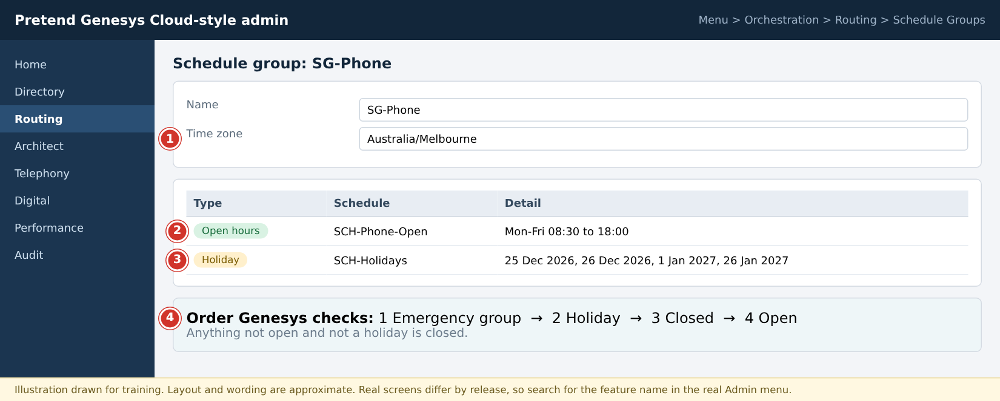
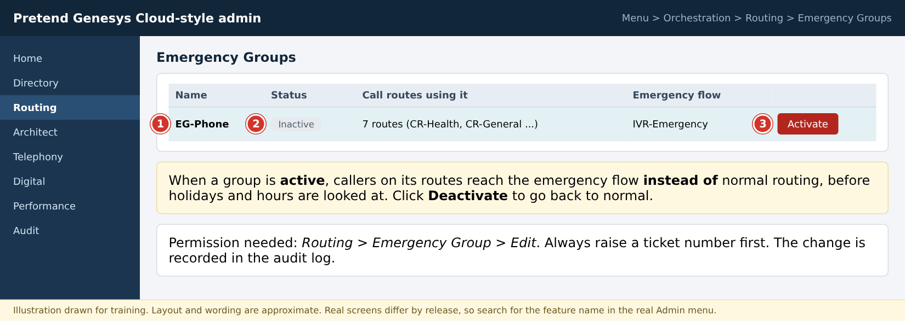

# Lesson 3. Hours, holidays and emergencies (about 50 minutes)

## 1. The ticket
> **CHG0010301.** Phone hours for the new year. Check the holiday list covers the next three months and confirm that calls on public holidays get the holiday message. Also: write down what to do if we must close the phones in an emergency.

## 2. The idea in plain English
A **schedule** says when we are open. A **schedule group** bundles the open hours with the holiday list. The call route asks the group one question: "right now, are we open, closed, on a holiday, or in an emergency?" Genesys checks in this order (from the Genesys help page "Operating schedule groups"):

> **Emergency first, then Holiday, then Closed, then Open.**

So a holiday beats open hours, and an active emergency beats everything. Anything that is not open and not a holiday is closed.

## 3. In the screen (GUI)
**Where:** Schedule Groups (and Schedules). Menus move, so search "Schedule Groups".

1. **Time zone** of the group. All times in it are read in this zone.
2. **Open hours** schedule: Monday to Friday, 08:30 to 18:00.
3. **Holiday** schedule: a list of dates. Both phone and chat groups use the same list.
4. The order Genesys checks.

**Emergency Groups.** The Genesys help page says the path is Menu > Orchestration > Routing > Emergency Groups. You find the group and click **Activate**. Callers on its routes then reach the emergency flow. **Deactivate** returns to normal.

1. The group. 2. Its status. 3. The **Activate** button: this one click affects every route using the group.

## 4. In PowerShell
### Step 1. Read the schedule group
```
PS> Get-WgScheduleGroup -Id SG-Phone
==> Schedule group SG-Phone  (Phone hours group, time zone Australia/Melbourne)
  OPEN     SCH-Phone-Open: Monday,Tuesday,Wednesday,Thursday,Friday  08:30-18:00
  HOLIDAY  SCH-Holidays: 4 dates
           2026-12-25  Christmas Day
           2026-12-26  Boxing Day
           2027-01-01  New Year's Day
           2027-01-26  Australia Day
```
**What it shows.** The open hours and the four holiday dates.

### Step 2. Test the edges of the day
Bugs live at boundaries. Test one minute either side:
```
PS> Test-WgSchedule -At "2026-11-16 08:29"
==> SG-Phone  Mon 16 Nov 2026 08:29  ->  CLOSED
  Why: Monday 08:29 is outside every open schedule
PS> Test-WgSchedule -At "2026-11-16 08:30"
==> SG-Phone  Mon 16 Nov 2026 08:30  ->  OPEN
  Why: Monday 08:30 is inside SCH-Phone-Open 08:30-18:00
PS> Test-WgSchedule -At "2026-11-16 17:59"
==> SG-Phone  Mon 16 Nov 2026 17:59  ->  OPEN
  Why: Monday 17:59 is inside SCH-Phone-Open 08:30-18:00
PS> Test-WgSchedule -At "2026-11-16 18:00"
==> SG-Phone  Mon 16 Nov 2026 18:00  ->  CLOSED
  Why: Monday 18:00 is outside every open schedule
PS> Test-WgSchedule -At "2026-11-14 10:00"
==> SG-Phone  Sat 14 Nov 2026 10:00  ->  CLOSED
  Why: Saturday 10:00 is outside every open schedule
```
**What it shows.** 08:29 is closed and 08:30 is open. 17:59 is open and **18:00 is closed** (the end time is not included). A Saturday is closed. `-At` is the date and time you are asking about.

### Step 3. A holiday beats open hours
```
PS> Test-WgSchedule -At "2026-12-25 10:00"
==> SG-Phone  Fri 25 Dec 2026 10:00  ->  HOLIDAY
  Why: 2026-12-25 is a holiday (Christmas Day)
PS> Trace-WgCall -Number "+61 3 5550 0401" -At "2026-12-25 10:00"
==> Call to +61 3 5550 0401 at Fri 25 Dec 2026 10:00
1. The number belongs to line L1 "Health sales and service". Its call route is CR-Health.
2. The route asks schedule group SG-Phone: HOLIDAY.  (2026-12-25 is a holiday (Christmas Day))
3. The route runs its holiday flow: IVR-Holiday (published v1).
4. Plays P-Holiday (the flow's published snapshot is v1).
       Caller hears: "Our phone team is closed today for a public holiday. We will be back on the next business day. You can send us an enquiry on our website, and we will reply within 3 to 5 business days."
5. The flow disconnects the call.
```
**What it shows.** 10:00 on Christmas Day is inside "open hours", but the holiday check comes first. The caller hears the holiday message and the call ends.

### Step 4. Is the holiday list about to run out?
```
PS> Test-WgHolidayCoverage -Today "2026-11-13"
The list has 4 holidays. The last is 2027-01-26, 74 days away.
 WARN  The list ends in less than 90 days. Add next year's dates before then.
```
**What it shows.** The list ends on 26 Jan 2027, 74 days away. Below 90 days it warns. A missing holiday is the classic cause of "calls went down the open path on a public holiday".

### Step 5. The 26 December trap
Look at the list again. 26 December 2026 is a **Saturday**, and Saturdays are already closed. Is anything missing?
```
PS> Test-WgSchedule -At "2026-12-28 10:00"
==> SG-Phone  Mon 28 Dec 2026 10:00  ->  OPEN
  Why: Monday 10:00 is inside SCH-Phone-Open 08:30-18:00
```
**What it shows.** Monday 28 December is OPEN. In many Australian states, when Boxing Day falls on a weekend, a **substitute weekday holiday** follows. Check the official list for your state: do not trust this book or your memory. Suppose the official list says 28 December is a holiday. Add it with a ticket:
```
PS> Add-WgHoliday -Date "2026-12-28" -Name "Boxing Day (substitute day)" -Ticket CHG0010301
  OK   Added 2026-12-28 Boxing Day (substitute day) to SCH-Holidays. Phone and chat both use this list, so both now treat it as a holiday.
PS> Test-WgSchedule -At "2026-12-28 10:00"
==> SG-Phone  Mon 28 Dec 2026 10:00  ->  HOLIDAY
  Why: 2026-12-28 is a holiday (Boxing Day (substitute day))
```
**What you learned.** A holiday list is not "copy the calendar". It is "copy the official list, and check weekends".

### Step 6. The emergency switch
```
PS> Set-WgEmergencyGroup -Id EG-Phone -Active $true -Ticket INC0010302
  OK   Emergency group EG-Phone is now ACTIVE: every phone line plays the emergency message.
PS> Trace-WgCall -Number "+61 3 5550 0405" -At "2026-11-16 10:15" -Keys 1
==> Call to +61 3 5550 0405 at Mon 16 Nov 2026 10:15
1. The number belongs to line L5 "Wealth and investments". Its call route is CR-Wealth.
2. The route asks schedule group SG-Phone: EMERGENCY.  (emergency group EG-Phone is ACTIVE)
3. The route runs its emergency flow: IVR-Emergency (published v2).
4. The flow checks schedule group SG-Chat: OPEN. So it plays P-Emergency (snapshot v1).
       Caller hears: "We are having a problem in our contact centre and cannot take calls right now. Please try again later, or chat with us online."
5. The flow disconnects the call.
PS> Set-WgEmergencyGroup -Id EG-Phone -Active $false -Ticket INC0010303
  OK   Emergency group EG-Phone is now OFF: normal routing.
PS> Get-WgAudit -Last 3
When                Ticket     Action          Target       Detail
----                ------     ------          ------       ------
2026-11-13 04:45:13 CHG0010301 holiday-add     SCH-Holidays 2026-12-28 Boxing Day (substitute day)
2026-11-13 04:45:14 INC0010302 emergency-group EG-Phone     active=True
2026-11-13 04:45:15 INC0010303 emergency-group EG-Phone     active=False
```
**What you see.** With the switch on, a call at 10:15 on a Monday (normally open) goes straight to the emergency message, and the menu never plays. Note that **every line** changed with one switch. Then it is turned off and both changes are in the audit log.

## 5. Why it is built this way (architect view)
- **Hours defined once, used by many.** The phone group serves all seven routes. One edit changes hours everywhere. The trade-off: one wrong edit breaks all seven lines at once. So changes are tested at the boundaries and done in a window.
- **Emergency sits above everything.** You do not need to know which flow, which hours, which holiday: one switch reroutes. That makes it usable at 2am by someone who is not the person who built the flow.
- **A shared holiday list for phone and chat.** One list, two groups. Good: fewer lists to forget. The catch: a date added for phones is also a chat holiday. Know that before you add it.
- **Time zone lives with the group,** so Daylight Saving changes follow the zone and nobody edits times twice a year. The risk is picking the wrong zone, and it is checked by testing at the edges.
- **Who may flip the emergency switch** is a design decision. The permission is separate (Routing > Emergency Group > Edit), so you can give it to a small, named group.

## 6. What goes wrong (first checks)
| Symptom | First check |
|---|---|
| Calls went down the open path on a public holiday | Is the date in the holiday list? (`Get-WgScheduleGroup`) Check substitute days. |
| Opens 30 minutes late or early | Time zone of the group; boundaries. |
| Emergency message will not stop | Is the emergency group still active? (`Get-WgEmergencyGroup`) |
| Phones and chat disagree about a holiday | They share one list: check the list and both groups. |

## 7. Improvements added in this lesson, and WHY
1. **A holiday coverage check** (`Test-WgHolidayCoverage`) on a monthly reminder. **Why:** an empty future list is invisible until the first missed holiday. A 90-day warning turns a surprise into a to-do.
2. **An emergency runbook.** Three lines: who may switch it, the ticket type (INC), and the check call afterwards. **Why:** under pressure people improvise. A short runbook makes the 2am switch safe.
3. **Boundary tests as standard** (08:29/08:30, 17:59/18:00). **Why:** off-by-one-minute mistakes are the most common schedule fault, and they are easy to prove with a test.

## 8. Check yourself
1. A call comes at 10:00 on a public holiday. Which wins: open hours or holiday? *(Holiday. Emergency is checked first, then holiday, then closed, then open.)*
2. You activate the emergency group at 3pm on a Tuesday. What happens to a caller dialling the wealth line? *(They hear the emergency message. Hours and holidays are not even looked at.)*
3. Why test 17:59 and 18:00 rather than just "5pm"? *(Boundaries are where mistakes hide: the end time is not included.)*

