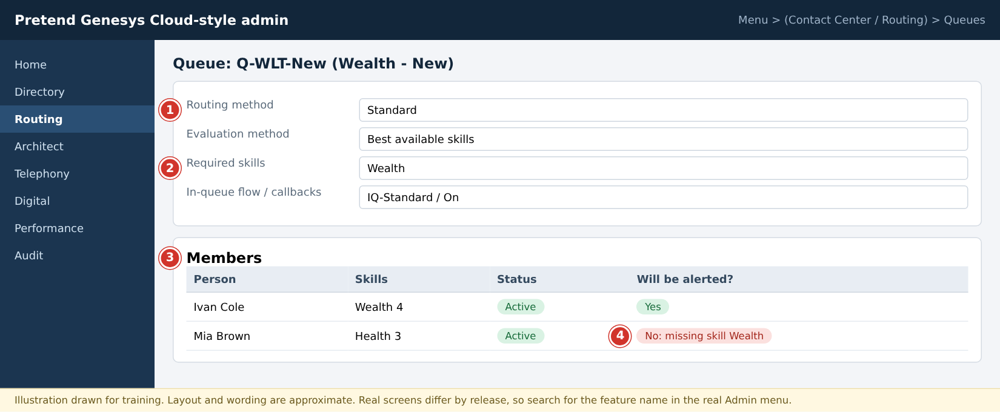
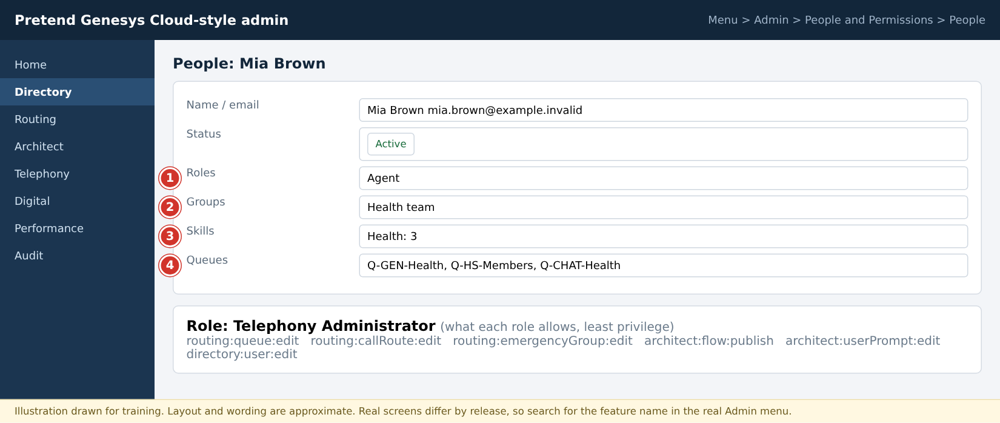

# Lesson 4. Queues, skills and people (about 50 minutes)

## 1. The ticket
> **RITM0010401.** New starter Mia Brown joins Health Service on Monday. Add her to the right queue and give her the skills. Also: Ivan Cole (Wealth) left last week. Make sure he cannot log in or get calls. Then check that queue membership matches what the team leader expects.

## 2. The idea in plain English
- A **queue** is a waiting line for a type of call. Agents who are **members** can be offered its calls.
- A **skill** is a label on a person ("Health", "Overseas Visitors") with a **proficiency** (how good, 0 to 5). A queue can say "only offer calls to people with this skill".
- A **role** is a bundle of permissions. A **group** is a list of people. A **division** limits which objects a role can see.

> **The trap.** Being a queue **member** is not the same as being **able to take its calls**. If the queue matches on skills, a member without the skill gets nothing. Adding someone to a queue and walking away is the most common "new starter gets no calls" ticket.

## 3. In the screen (GUI)
**Where:** Admin > Contact Center > Queues, then People.

1. Queue name and division.
2. **Routing method** (Standard or Bullseye) and the **evaluation method** (Best Available Skills, All Skills Matching, Disregard Skills).
3. The **skills** the queue wants.
4. **Members**: who may get calls.

1. The person. 2. Their roles. 3. Their skills and proficiency. 4. Their queues.

## 4. In PowerShell
### Step 1. Look at the queue
```
PS> Get-WgQueue -Id Q-HS-Members
==> Queue Q-HS-Members  (Health - Members)
  Routing method Standard, evaluation BestAvailableSkills, service level target 80/20, in-queue flow IQ-Standard, callbacks True
  Skills the queue asks for: Health

Member      Active MissingSkills Proficiency WillBeAlerted
------      ------ ------------- ----------- -------------
Alex Reed     True                      4.00          True
Bree Nguyen   True                      5.00          True
Dana Singh    True                      4.00          True
Kim Lowe      True                      5.00          True
```
**What it shows.** The queue, the skills it wants, how it matches skills, and who is in it.

### Step 2. Add the new starter
```
PS> Get-WgUser
Id  Name                          Role                    Groups                     Skills                      Active
--  ----                          ----                    ------                     ------                      ------
U01 Alex Reed                     Agent                   Health team                Health:4 Sales:3              True
U02 Bree Nguyen                   Agent                   Health team                Health:5                      True
U03 Carlos Diaz                   Agent                   Health team                Health:3 Sales:5              True
U04 Dana Singh                    Agent                   Health team                Health:4 Overseas:4           True
U05 Eli Moore                     Agent                   Health team                Health:2 Overseas:5           True
U06 Fay Tran                      Agent                   Insurance team             GeneralInsurance:4 Claims:3   True
U07 Gus Park                      Agent                   Insurance team             Claims:5                      True
U08 Hana Ito                      Agent                   General team               Health:3 GeneralInsurance:3   True
U09 Ivan Cole                     Agent                   Wealth and funeral team    Wealth:4                      True
U10 June Park                     Agent                   Wealth and funeral team    Funeral:4 Wholesale:3         True
U11 Kim Lowe                      Team Leader             Team leaders / Health team Health:5                      True
U12 Lee Ahmed                     Reporting Analyst       Telephony systems                                        True
U13 Mia Brown                     Agent                   Health team                Health:3                      True
U14 You (Telephony Administrator) Telephony Administrator Telephony systems                                        True
PS> Add-WgQueueMember -Queue Q-HS-Members -User U13 -Ticket RITM0010401
  OK   Added Mia Brown to Health - Members.
```
**What it does.** `Get-WgUser` lists everyone with their IDs. Mia Brown is U13 and already has the Health skill, so the add is clean.

### Step 3. The trap: a member without the skill
To see the trap, add someone who has no Health skill (the reporting analyst, only to practise), then fix it and undo it:
```
PS> Add-WgQueueMember -Queue Q-HS-Members -User U12 -Ticket RITM0010401
  OK   Added Lee Ahmed to Health - Members.
 WARN  Lee Ahmed is a member but is missing skill(s): Health. They will NOT be alerted until the skill is added.
PS> Get-WgQueue -Id Q-HS-Members
==> Queue Q-HS-Members  (Health - Members)
  Routing method Standard, evaluation BestAvailableSkills, service level target 80/20, in-queue flow IQ-Standard, callbacks True
  Skills the queue asks for: Health

Member      Active MissingSkills Proficiency WillBeAlerted
------      ------ ------------- ----------- -------------
Alex Reed     True                      4.00          True
Bree Nguyen   True                      5.00          True
Dana Singh    True                      4.00          True
Kim Lowe      True                      5.00          True
Mia Brown     True                      3.00          True
Lee Ahmed     True Health                  0         False
PS> Add-WgUserSkill -User U12 -Skill Health -Proficiency 3 -Ticket RITM0010401
  OK   Lee Ahmed now has skill Health at proficiency 3.
PS> Remove-WgQueueMember -Queue Q-HS-Members -User U12 -Ticket RITM0010401
  OK   Removed Lee Ahmed from Health - Members.
```
**What it does.** The add prints a warning: this person is in the queue but will NOT be alerted. The queue table shows `WillBeAlerted False`. `Add-WgUserSkill` gives the skill (`-Proficiency 3` is an example; use what the team leader says). The last line takes the practice member out again. A command that only did the "add" would hide the problem.

### Step 4. The leaver
```
PS> Disable-WgUser -User U09 -Ticket RITM0010402
  OK   Ivan Cole: removed from 2 queue(s), groups cleared, account deactivated.
PS> Compare-WgQueueMembership -IntendedCsv ./automation/intended-membership.csv
==> Queue membership check
  OK   7 intended pairs, 7 actual pairs (in the queues named in the list)
  OK   Membership matches the list.
```
**What it does.** `Disable-WgUser` turns the account off **and** takes the person out of every queue, so no call is offered to someone who has left. `Compare-WgQueueMembership` reads a list of who SHOULD be in each queue (the team leader's file) and shows every difference: extra people, missing people.

### Step 5. Least privilege: who can do what?
```
PS> Get-WgRole
==> Role R-Agent  (Agent)
  conversation:call:accept
  conversation:callback:accept
  routing:queue:view-own
==> Role R-TeamLead  (Team Leader)
  conversation:call:accept
  routing:queue:view
  analytics:queueObservation:view
  analytics:agent:view
==> Role R-Reporting  (Reporting Analyst)
  analytics:queueAggregate:view
  analytics:conversationDetail:view
==> Role R-TelAdmin  (Telephony Administrator)
  routing:queue:edit
  routing:callRoute:edit
  routing:emergencyGroup:edit
  routing:scheduleGroup:edit
  architect:flow:publish
  architect:userPrompt:edit
  directory:user:edit
==> Role R-Auditor  (Auditor (view only))
  audit:audit:view
  routing:queue:view
  architect:flow:view
PS> Get-WgAudit -Last 5
When                Ticket      Action       Target       Detail
----                ------      ------       ------       ------
2026-11-13 04:45:17 RITM0010401 queue-add    Q-HS-Members U13
2026-11-13 04:45:18 RITM0010401 queue-add    Q-HS-Members U12
2026-11-13 04:45:19 RITM0010401 skill-add    U12          Health:3
2026-11-13 04:45:19 RITM0010401 queue-remove Q-HS-Members U12
2026-11-13 04:45:19 RITM0010402 leaver       U09          removed from 2 queues, groups cleared, deactivated
```
**What it shows.** The roles and what each can do. You should hold the least you need. The audit lists every change with who and why.

## 5. Why it is built this way (architect view)
- **Skills over many queues.** Instead of one queue for every language and product, a few queues with skill matching keep the list short and the routing flexible. The cost is complexity: you must keep skills clean.
- **Membership by file.** The intended list lives in a CSV that the team leader owns. The lab compares it with the real thing. This is the idea behind "configuration as the source of truth", and it is how you find drift.
- **Leavers are a security job** as much as a routing job. A disabled but still-queued account silently eats calls.
- **Divisions** limit which queues, flows and users a role can touch. Use them when a business unit must not edit another unit's setup. In a shared PHI and wealth org this matters.
- **Least privilege.** The more people who can change routing, the more accidents. Keep admin roles few and named.

## 6. What goes wrong (first checks)
| Symptom | First check |
|---|---|
| New starter gets no calls | Skills on the person vs skills on the queue |
| Calls ring someone who has left | Is the account disabled AND out of queues? |
| Two team leaders disagree who is in a queue | `Compare-WgQueueMembership` against the CSV |
| "Who changed the queue?" | `Get-WgAudit` |
| Agent can see a queue they should not | Role and division |

## 7. Improvements added in this lesson, and WHY
1. **A warning when a member lacks the queue's skill.** **Why:** the real failure is silent: no error, just no calls.
2. **A leaver check that removes queue membership too.** **Why:** a leaver with an active membership is a security gap and a routing hole.
3. **Monthly membership comparison to a team-leader file.** **Why:** drift is invisible until a call is missed. A report makes it a routine task.

## 8. Check yourself
1. A new starter is in the queue but gets no calls. What do you check first? *(Whether they have the skill the queue is matching on.)*
2. Why remove a leaver from queues and not only disable the account? *(So no call is offered to them, and so the report is clean.)*
3. What is a division for? *(It limits which objects a role can see and change.)*

