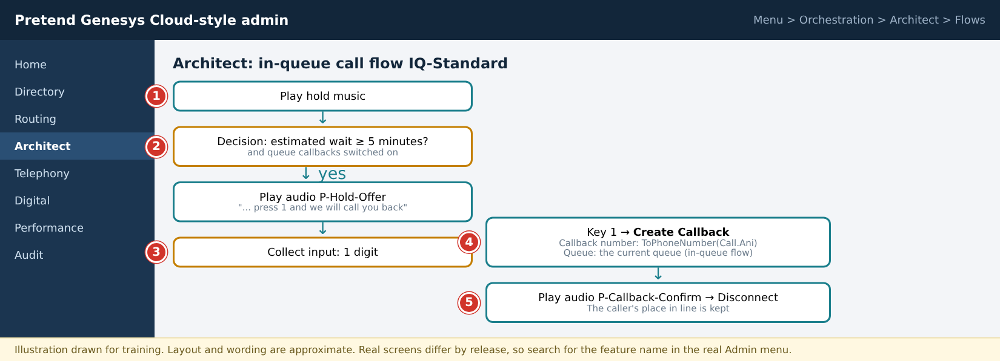

# Lesson 5. Callbacks (about 45 minutes)

## 1. The ticket
> **RITM0010501.** Members hang up when the wait is long. Offer a callback when the wait is 5 minutes or more. Check what happens with a short wait, with a queue that has callbacks turned off, and with a number that is not valid. Also let people ask for a callback from the website, including after hours.

## 2. The idea in plain English
A **callback** means: "keep your place, we will ring you". Two kinds exist in Genesys:
- **In-queue callback (ACD).** Offered while waiting. The caller keeps their place in line. The system calls them when an agent is free.
- **Scheduled callback.** A callback at a chosen time.

In an Architect in-queue flow, the **Create Callback** action makes the callback. It needs a **callback number**, and it uses the caller's phone number (ANI) by default. It cannot choose a time by itself. Check the current Genesys help page for details before relying on this.

> **Best practice.** Ask for an **alternate number**. The caller's ANI may be a blocked, withheld or mobile number they will not answer.

## 3. In the screen (GUI)
**Where:** Architect > In-queue flows.

1. The decision: is the estimated wait 5 minutes or more?
2. The offer prompt ("press 1 to keep your place and we will call you").
3. **Create Callback** action: the number and the queue.
4. The confirmation prompt, then end.

## 4. In PowerShell
### Step 1. Long wait: callback offered
```
PS> Trace-WgCall -Number "+61 3 5550 0401" -At "2026-11-16 10:15" -Keys 1 -WaitMinutes 8 -AcceptCallback
==> Call to +61 3 5550 0401 at Mon 16 Nov 2026 10:15
1. The number belongs to line L1 "Health sales and service". Its call route is CR-Health.
2. The route asks schedule group SG-Phone: OPEN.  (Monday 10:15 is inside SCH-Phone-Open 08:30-18:00)
3. The route runs its open flow: IVR-Health-Open (published v1).
4. Notice slot for L1 is OFF, so nothing extra plays.
5. Plays P-Greet-Health (the flow's published snapshot is v1).
       Caller hears: "Thanks for calling Wattle Health."
6. Menu, pass 1 of 2: plays P-Menu-Health (v1).
       Caller hears: "If you are already a member and need help with your cover, press 1. To join or ask for a quote, press 2. For overseas visitor and student cover, press 3. For home, car or travel insurance, press 4."
   Caller presses 1: "existing member".
7. The call joins queue Q-HS-Members "Health - Members" (routing Standard, skills: Health).
   Genesys would alert: Bree Nguyen (proficiency 5), Kim Lowe (proficiency 5), Alex Reed (proficiency 4)  (best available skills)
8. No agent is free. The queue says the wait is about 8 minutes, so the in-queue flow IQ-Standard runs.
   Hold music plays.
   Wait is 5+ minutes, so the callback is offered.
       Caller hears: "All of our team are busy right now. Your estimated wait is about 8 minutes. To keep your place and have us call you back, press 1. Otherwise, please stay on the line."
   Caller presses 1. A callback CB0001 is placed in queue Q-HS-Members for +61 4 9157 0156. The caller's place in line is kept.
       Caller hears: "Thank you. We will call you back as soon as a team member is free. Goodbye."
```
**What it does.** Simulates a call at 10:15 with an 8-minute wait. `-WaitMinutes 8` is the pretend wait. `-AcceptCallback` means the caller presses 1 to accept. The trace shows the offer, the callback being created, and the confirmation.

### Step 2. Short wait: no offer
```
PS> Trace-WgCall -Number "+61 3 5550 0401" -At "2026-11-16 10:15" -Keys 1 -WaitMinutes 2
==> Call to +61 3 5550 0401 at Mon 16 Nov 2026 10:15
1. The number belongs to line L1 "Health sales and service". Its call route is CR-Health.
2. The route asks schedule group SG-Phone: OPEN.  (Monday 10:15 is inside SCH-Phone-Open 08:30-18:00)
3. The route runs its open flow: IVR-Health-Open (published v1).
4. Notice slot for L1 is OFF, so nothing extra plays.
5. Plays P-Greet-Health (the flow's published snapshot is v1).
       Caller hears: "Thanks for calling Wattle Health."
6. Menu, pass 1 of 2: plays P-Menu-Health (v1).
       Caller hears: "If you are already a member and need help with your cover, press 1. To join or ask for a quote, press 2. For overseas visitor and student cover, press 3. For home, car or travel insurance, press 4."
   Caller presses 1: "existing member".
7. The call joins queue Q-HS-Members "Health - Members" (routing Standard, skills: Health).
   Genesys would alert: Bree Nguyen (proficiency 5), Kim Lowe (proficiency 5), Alex Reed (proficiency 4)  (best available skills)
8. No agent is free. The queue says the wait is about 2 minutes, so the in-queue flow IQ-Standard runs.
   Hold music plays.
   The wait is under 5 minutes, so no callback offer is made.
```
**What it shows.** Under 5 minutes, no offer. Offering a callback for a 2-minute wait only annoys people.

### Step 3. A queue with callbacks turned off
```
PS> Get-WgQueue -Id Q-GEN-Other
==> Queue Q-GEN-Other  (General - Other)
  Routing method Standard, evaluation BestAvailableSkills, service level target 80/20, in-queue flow IQ-NoCallback, callbacks False
  Skills the queue asks for: (none)

Member   Active MissingSkills Proficiency WillBeAlerted
------   ------ ------------- ----------- -------------
Hana Ito   True                         0          True
PS> Trace-WgCall -Number "+61 3 5550 0402" -At "2026-11-16 10:15" -Keys 9 -WaitMinutes 8
==> Call to +61 3 5550 0402 at Mon 16 Nov 2026 10:15
1. The number belongs to line L2 "General inquiries". Its call route is CR-General.
2. The route asks schedule group SG-Phone: OPEN.  (Monday 10:15 is inside SCH-Phone-Open 08:30-18:00)
3. The route runs its open flow: IVR-General-Open (published v1).
4. Notice slot for L2 is OFF, so nothing extra plays.
5. Plays P-Greet-General (the flow's published snapshot is v1).
       Caller hears: "Thanks for calling Wattle Group."
6. Menu, pass 1 of 2: plays P-Menu-General (v1).
       Caller hears: "For health cover, press 1. For any other insurance, press 2. For anything else, press 3."
 WARN     Caller presses 9: not a menu option. The flow says it did not understand and plays the menu again.
6. Menu, pass 2 of 2: plays P-Menu-General (v1).
       Caller hears: "For health cover, press 1. For any other insurance, press 2. For anything else, press 3."
   Caller says and presses nothing. After 5 seconds the menu plays again.
 WARN     No valid key after 2 passes, so the flow sends the call to the default: Q-GEN-Other.
7. The call joins queue Q-GEN-Other "General - Other" (routing Standard, skills: none).
   Genesys would alert: Hana Ito (proficiency 0)  (best available skills)
8. No agent is free. The queue says the wait is about 8 minutes, so the in-queue flow IQ-NoCallback runs.
   Hold music plays.
```
**What it shows.** This queue uses a different in-queue flow without a callback offer. A long wait still gets no offer. This is a design decision, and it is a question to ask the business, "why not?".

### Step 4. A bad callback number
```
PS> Trace-WgCall -Number "+61 3 5550 0401" -At "2026-11-16 10:15" -Keys 1 -WaitMinutes 8 -AcceptCallback -CallbackNumber "12345"
==> Call to +61 3 5550 0401 at Mon 16 Nov 2026 10:15
1. The number belongs to line L1 "Health sales and service". Its call route is CR-Health.
2. The route asks schedule group SG-Phone: OPEN.  (Monday 10:15 is inside SCH-Phone-Open 08:30-18:00)
3. The route runs its open flow: IVR-Health-Open (published v1).
4. Notice slot for L1 is OFF, so nothing extra plays.
5. Plays P-Greet-Health (the flow's published snapshot is v1).
       Caller hears: "Thanks for calling Wattle Health."
6. Menu, pass 1 of 2: plays P-Menu-Health (v1).
       Caller hears: "If you are already a member and need help with your cover, press 1. To join or ask for a quote, press 2. For overseas visitor and student cover, press 3. For home, car or travel insurance, press 4."
   Caller presses 1: "existing member".
7. The call joins queue Q-HS-Members "Health - Members" (routing Standard, skills: Health).
   Genesys would alert: Bree Nguyen (proficiency 5), Kim Lowe (proficiency 5), Alex Reed (proficiency 4)  (best available skills)
8. No agent is free. The queue says the wait is about 8 minutes, so the in-queue flow IQ-Standard runs.
   Hold music plays.
   Wait is 5+ minutes, so the callback is offered.
       Caller hears: "All of our team are busy right now. Your estimated wait is about 8 minutes. To keep your place and have us call you back, press 1. Otherwise, please stay on the line."
 FAIL     Callback refused: "+12345" is not a valid Australian number. The Create Callback action needs a number, and it cannot be blank.
```
**What it shows.** The number is rejected and the caller is not given a false promise. A callback to a number that cannot be dialled is worse than none.

### Step 5. A callback from the website, even after hours
```
PS> Request-WgCallback -Queue Q-HS-Members -Name "Sam Lee" -Number "+61 400 000 111" -At "2026-11-16 20:00"
  OK   Callback CB0002 for Sam Lee placed in Health - Members.
 WARN  The phone team is CLOSED right now (Monday 20:00 is outside every open schedule). The callback waits and the agent calls when the line next opens. The form should say so.
PS> Get-WgCallback
Id     Queue        Number          Source   Requested        Status
--     -----        ------          ------   ---------        ------
CB0001 Q-HS-Members +61 4 9157 0156 in-queue 2026-11-16 10:15 Waiting
CB0002 Q-HS-Members +61 4 0000 0111 web-form 2026-11-16 20:00 Waiting
```
**What it does.** `-At` pretends it is Monday 8pm (the phones are closed). Records a callback request from the web form. The callback is for the **next open time**, not for now, and the list shows it. This is the after-hours option.

## 5. Why it is built this way (architect view)
- **The 5-minute rule is a threshold, not a law.** It is data in the flow, so it can be tuned from real wait times. Start from reports: look at the 75th-percentile wait, then choose.
- **A callback keeps the queue position** so it is fairer than redial. But it moves work to later: plan agent capacity, or callbacks pile up at close.
- **Alternate number** is a quality fix. In the lab and in real life, wrong numbers are the main reason callbacks fail.
- **Callbacks and hours.** A callback made at 17:50 should not ring at 19:00. Decide the rule (expire, or move to next open day) and document it.
- **Why the website path is separate.** A web request is not a call in a queue. It needs its own handling and a clear promise to the member.

## 6. What goes wrong (first checks)
| Symptom | First check |
|---|---|
| No callback offered | Wait threshold, queue flow, callbacks on for that queue |
| Callback never rings | Number format, hours, agent availability |
| Callback rings at 7pm | Expiry rule |
| Many callbacks at close | Capacity and shift end |

## 7. Improvements added in this lesson, and WHY
1. **Ask for an alternate number.** **Why:** the caller's own number is often withheld or unanswered.
2. **Validate the number before promising a call.** **Why:** a broken promise costs more trust than not offering.
3. **Tune the threshold from reports.** **Why:** 5 minutes is a guess until data says otherwise.

## 8. Check yourself
1. What are the two kinds of callback? *(In-queue ACD and scheduled.)*
2. Why validate the callback number? *(A callback that cannot be dialled breaks a promise.)*
3. A callback is requested at 17:55. When should it ring? *(A business decision: documented and tested. Not 19:00.)*

