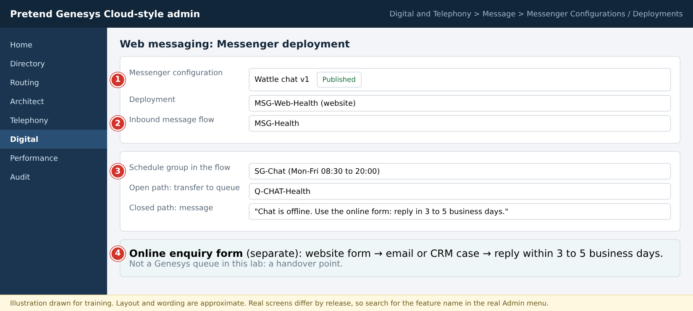

# Lesson 6. Online options: webchat and the enquiry form (about 40 minutes)

## 1. The ticket
> **RITM0010601.** The website shows webchat 8:30am to 8pm Monday to Friday, and an online form with a reply in 3 to 5 business days. Check that the closed message is truthful: at 7pm the phones are closed but chat is open, and the message should say so. After 8pm it should not.

## 2. The idea in plain English
Three doors, three clocks:
| Door | Hours or promise | Where it lives |
|---|---|---|
| Phone | 8:30am to 6pm, Mon to Fri | Call route, IVR flow, queues |
| Webchat | 8:30am to 8pm, Mon to Fri | Messenger deployment and inbound message flow |
| Enquiry form | Reply in 3 to 5 business days | A **handover**: it creates a task for staff. It is not a Genesys queue here. |

A closed message that says "try our chat" at 9pm is a lie. So the closed message must **check the chat clock**.

## 3. In the screen (GUI)
**Where:** Admin > Message > Messenger Configuration, Messenger Deployment, then an Architect inbound message flow.

1. The Messenger configuration (look, colours, behaviour).
2. The deployment: where the widget appears and which flow handles it.
3. The message flow: checks the chat schedule before offering an agent.
4. The enquiry form link shown when chat is closed.

## 4. In PowerShell
### Step 1. Is chat open? Test the edges
```
PS> Test-WgChat -At "2026-11-16 18:30"
==> Chat at Mon 16 Nov 18:30: OPEN
  Why: Monday 18:30 is inside SCH-Chat-Open 08:30-20:00
  (For comparison, the phone line is CLOSED at the same time.)
  The visitor sees: "Hi, you are chatting with Wattle Group. How can we help?"  (2 agent(s) can take chat in Q-CHAT-Health)
PS> Test-WgChat -At "2026-11-16 19:59"
==> Chat at Mon 16 Nov 19:59: OPEN
  Why: Monday 19:59 is inside SCH-Chat-Open 08:30-20:00
  (For comparison, the phone line is CLOSED at the same time.)
  The visitor sees: "Hi, you are chatting with Wattle Group. How can we help?"  (2 agent(s) can take chat in Q-CHAT-Health)
PS> Test-WgChat -At "2026-11-16 20:00"
==> Chat at Mon 16 Nov 20:00: CLOSED
  Why: Monday 20:00 is outside every open schedule
  (For comparison, the phone line is CLOSED at the same time.)
  The visitor sees: "Our chat team is offline right now. Chat is open from 8:30am to 8pm, Monday to Friday. You can send us an enquiry using the online form and we will reply within 3 to 5 business days."
PS> Test-WgChat -At "2026-11-14 10:00"
==> Chat at Sat 14 Nov 10:00: CLOSED
  Why: Saturday 10:00 is outside every open schedule
  (For comparison, the phone line is CLOSED at the same time.)
  The visitor sees: "Our chat team is offline right now. Chat is open from 8:30am to 8pm, Monday to Friday. You can send us an enquiry using the online form and we will reply within 3 to 5 business days."
```
**What it shows.** Chat is open at 18:30 (phones closed), open at 19:59, closed at 20:00 and closed on a Saturday.

### Step 2. The closed message, with and without chat
```
PS> Trace-WgCall -Number "+61 3 5550 0401" -At "2026-11-16 19:00"
==> Call to +61 3 5550 0401 at Mon 16 Nov 2026 19:00
1. The number belongs to line L1 "Health sales and service". Its call route is CR-Health.
2. The route asks schedule group SG-Phone: CLOSED.  (Monday 19:00 is outside every open schedule)
3. The route runs its closed flow: IVR-Closed (published v2).
4. The flow checks schedule group SG-Chat: OPEN. So it plays P-Closed (snapshot v1).
       Caller hears: "Our phone team is closed right now. We are open Monday to Friday, from 8:30 in the morning to 6 in the evening. Please call back then, or chat with us online, which is open until 8 in the evening on weekdays."
5. The flow disconnects the call.
PS> Trace-WgCall -Number "+61 3 5550 0401" -At "2026-11-16 20:30"
==> Call to +61 3 5550 0401 at Mon 16 Nov 2026 20:30
1. The number belongs to line L1 "Health sales and service". Its call route is CR-Health.
2. The route asks schedule group SG-Phone: CLOSED.  (Monday 20:30 is outside every open schedule)
3. The route runs its closed flow: IVR-Closed (published v2).
4. The flow checks schedule group SG-Chat: CLOSED. So it plays P-Closed-NoChat (snapshot v1).
       Caller hears: "Our phone team is closed right now. We are open Monday to Friday, from 8:30 in the morning to 6 in the evening. Please call back then, or send us an enquiry on our website, and we will reply within 3 to 5 business days."
5. The flow disconnects the call.
```
**What it shows.** At 19:00 the caller is told chat is open. At 20:30 they get a version that sends them to the form only. The flow uses a step called `playIfOpen`: it plays the chat line only if the chat group is open.

### Step 3. When will the form be answered?
```
PS> Get-WgEnquiryDue -Submitted "2026-12-23 15:00"
==> Enquiry submitted Wed 23 Dec 2026.
  Reply promised between Tue 29 Dec and Thu 31 Dec (3 to 5 business days, weekends and public holidays skipped).
  Handled by: Email or CRM case (not Genesys in this lab: a handover point)
```
**What it shows.** The 3 to 5 business day window, skipping weekends and the holiday list. A form sent on 23 December falls over Christmas, so the promised window is 29 to 31 December, not "early next week". If the substitute holiday (28 Dec) is added in Lesson 3, the window moves one day later.

## 5. Why it is built this way (architect view)
- **One honest message per moment.** Two prompts (with chat, without chat) cost a little more upkeep, but each is always true.
- **The form is a handover.** It needs an owner and a queue-like process, or 3 to 5 days becomes never. Ask who owns it, and how it is measured.
- **One holiday list for all three doors** keeps the answer consistent.
- **Messaging has its own flow type.** Do not assume a voice flow fits chat.

## 6. What goes wrong (first checks)
| Symptom | First check |
|---|---|
| Chat widget not showing | Deployment status and allowed domain |
| Chat opens at the wrong time | Chat schedule group and time zone |
| Phone message mentions chat when it is closed | Which closed prompt is used |
| Form answered late | Business-day calculation and owner |

## 7. Improvements added in this lesson, and WHY
1. **Chat-aware closed message.** **Why:** a message that promises something that is not there damages trust.
2. **Show the reply date, not a range, on the form confirmation.** **Why:** a date is a promise people can check.
3. **A named owner for the form.** **Why:** shared inboxes with no owner fail quietly.

## 8. Check yourself
1. At 7pm Monday, phones are closed. What should the closed message say about chat? *(That it is open until 8pm.)*
2. Why is the form not a queue in this lab? *(It is a handover of work with a reply promise, not a live conversation.)*
3. Why should the holiday list be shared? *(So all three doors agree on closed days.)*

